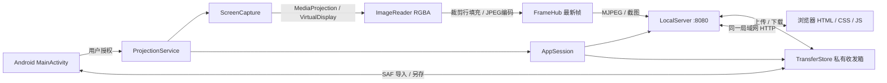
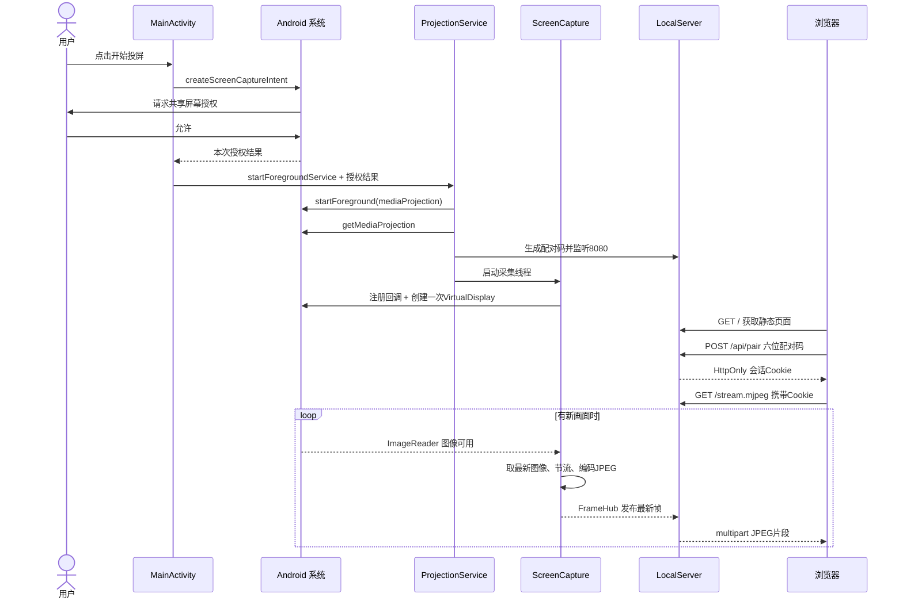

# 轻投 AirBridge：实现原理与技术设计

本文对应仓库当前实现，供后续维护、排错和扩展使用。Android 最低版本为 8.0（API 26），`compileSdk` / `targetSdk` 为 35，源码使用 Java 17；浏览器端使用原生 HTML、CSS、JavaScript，无前端运行时依赖。

## 1. 目标与方案选择

手机和电脑连接同一 Wi-Fi，或电脑连接手机热点。手机经系统授权采集桌面，内置 HTTP 服务同时提供浏览器页面、画面流和文件接口。电脑不安装客户端，输入手机显示的地址和本次六位配对码即可使用。

当前实现：桌面画面、观看暂停/继续、截图、全屏、手机与浏览器双向传文件。没有声音采集、远程触摸控制、公网穿透、断点续传或视频录制。暂停观看只关闭该浏览器的画面连接；手机停止投屏会关闭整个会话及文件接口。

| 方案 | 本项目中的取舍 |
| --- | --- |
| HTTP + MJPEG，当前采用 | 每帧独立 JPEG，浏览器 `` 可以解码；无需信令服务和视频编解码依赖，便于验证；带宽和 JPEG 编码开销较高 |
| WebRTC，未来候选 | 适合低延迟视频和声音，但需视频编码、信令、连接协商及更多兼容性工作 |
| WebSocket + JPEG | 可以自定义帧控制，但仍有 JPEG 成本，且要额外实现协议和浏览器解码/绘制逻辑；当前收益不足 |

这一版优先覆盖桌面演示、查看手机内容和临时文件交换。是否升级 WebRTC，应由真机上的延迟、温升和带宽测量决定。

## 2. 组件与数据流



| 源文件 | 职责 |
| --- | --- |
| [`MainActivity.java`](../app/src/main/java/dev/airbridge/MainActivity.java) | 手机界面、系统授权、画质选择、文件选择和另存 |
| [`ProjectionService.java`](../app/src/main/java/dev/airbridge/ProjectionService.java) | 前台通知、采集会话生命周期、启动/停止服务 |
| [`ScreenCapture.java`](../app/src/main/java/dev/airbridge/ScreenCapture.java) | VirtualDisplay、图像像素处理、节流、尺寸变化、释放资源 |
| [`AppSession.java`](../app/src/main/java/dev/airbridge/AppSession.java) | 进程内共享状态、随机配对码、地址枚举、Android 后端适配 |
| [`server/FrameHub.java`](../app/src/main/java/dev/airbridge/server/FrameHub.java) | 只保留最新 JPEG 的同步邮箱 |
| [`server/LocalServer.java`](../app/src/main/java/dev/airbridge/server/LocalServer.java) | HTTP 解析、配对/鉴权、画面流、下载/上传路由 |
| [`TransferStore.java`](../app/src/main/java/dev/airbridge/TransferStore.java) | 有界流式落盘、UUID 索引、元数据恢复、导入/导出 |
| [`assets/web/app.js`](../app/src/main/assets/web/app.js) | 配对、轮询、画面状态、上传队列、文件列表 |

## 3. 从点击开始到浏览器显示



授权结果只用于当前会话。服务使用 `START_NOT_STICKY`，不会依靠系统重建时偷偷复用旧授权。Android 14+ 请求默认显示屏共享；创建 VirtualDisplay 前先注册 `MediaProjection.Callback`，调整尺寸时复用同一个 VirtualDisplay。这些限制来自平台的投屏会话规则。[Android MediaProjection 文档](https://developer.android.com/media/grow/media-projection)

Manifest 声明 `FOREGROUND_SERVICE`、`FOREGROUND_SERVICE_MEDIA_PROJECTION` 和 `foregroundServiceType="mediaProjection"`。服务先显示持续通知，再调用 `getMediaProjection`；通知提供停止入口。Android 13+ 会请求通知权限，拒绝通知权限不等于屏幕采集已获授权，仍需单独完成系统投屏授权。[前台服务类型说明](https://developer.android.com/develop/background-work/services/fgs/service-types)

## 4. Android 图像采集

### 4.1 Surface 与缓冲区

`VirtualDisplay` 把授权画面渲染到 `ImageReader` 的 Surface。`ImageReader` 使用 `RGBA_8888`，最多持有 3 张图像；回调在 `AirBridge-Capture` HandlerThread 上执行，不在 UI 线程编码。

图像可用回调调度一次待执行采集任务；任务到期调用 `acquireLatestImage()`，丢弃队列中的旧图像，每次取得的 Image 都通过 try-with-resources 关闭。漏掉 `Image.close()` 会耗尽图像缓冲区，使采集停止，因此关闭动作不能只放在“成功编码”分支。[ImageReader API](https://developer.android.com/reference/android/media/ImageReader)

### 4.2 行填充和像素转换

图像每行的实际存储长度 `rowStride` 可能大于 `width × 4`，`pixelStride` 也必须检查。直接把完整缓冲区当作宽高严格相等的 Bitmap，会引入右边条带、越界读取或错误颜色。

当前分三条路径处理：

1. `pixelStride == 4` 且行连续：限制可见字节区间后直接复制到复用的 ARGB_8888 Bitmap。
2. `pixelStride == 4` 但每行有填充：逐行只复制 `width × 4` 个可见字节到复用的紧凑 ByteBuffer，再写入 Bitmap。最后一行可能没有完整填充区，因此不读取“虚构的补齐像素”。
3. 其他至少 4 字节的像素步长：逐像素读取 RGBA，组合成 ARGB 整数写入 Bitmap；过小步长作为异常处理。

这里的“裁剪”是去掉内存行填充，输出内容仍按系统授予的显示区域采集，没有额外实现用户框选裁剪。

### 4.3 画质与节流

| 手机档位 | 最长边上限 | 目标帧率 | JPEG quality |
| --- | ---: | ---: | ---: |
| 省流 | 960 px | 8 FPS | 50 |
| 均衡（默认） | 1280 px | 12 FPS | 65 |
| 清晰 | 1920 px | 15 FPS | 80 |

最长边缩放保持宽高比，原始尺寸较小时不放大。例如 1080 × 1920 桌面在均衡档输出约 720 × 1280。界面上的档位数字应理解为最长边上限，不是所有设备都会得到同一分辨率。

`uptimeMillis` 与 `1000 / targetFps` 控制编码频率；图像过早到达时只安排一个延后任务，到时间再获取最新图像。这样静止画面的最后一次变化也会被编码，不会因“本帧太早，直接丢弃”而等待一个永远不来的后续回调。尺寸变化和停止时取消待执行任务。

Bitmap、紧凑像素缓冲区、JPEG 输出流会复用；发布时 `toByteArray()` 产生该帧独立字节数组，避免下一次编码覆盖正在发送的内容。FPS 是目标上限，不是已测得的实际吞吐。

### 4.4 旋转与释放

Android 14+ 使用 `onCapturedContentResize`；更早系统通过默认显示屏变化回调重新计算尺寸。尺寸变化时新建 ImageReader、解绑旧 Surface、调用 `VirtualDisplay.resize()`、绑定新 Surface，关闭旧 Reader 并清空旧尺寸帧。

停止、系统撤销共享或采集异常最终释放显示监听、projection 回调、VirtualDisplay、ImageReader、Bitmap 和投影实例，并结束采集线程。手机服务销毁还会关闭 HTTP 监听及客户端连接、清空帧和配对码，并为下一会话更换 FrameHub，避免旧采集线程的延迟释放清掉新会话画面。常驻通知和 App 停止按钮都进入这一生命周期。

## 5. JPEG 如何连续显示成投屏

浏览器设置 ``。HTTP 响应的 Content-Type 为 `multipart/x-mixed-replace; boundary=airbridge`，随后在一个响应中不断发送以下片段：

```http
--airbridge\r\n
Content-Type: image/jpeg\r\n
Content-Length: <当前JPEG字节数>\r\n
\r\n
<JPEG二进制数据>\r\n
```

上面的 `\r\n` 表示实际 CRLF 字节；每片的 Content-Length 描述 JPEG，整个持续响应没有固定总长度。浏览器不断用新图替换旧图，不需要应用代码逐帧绘制 Canvas。截图接口直接返回 FrameHub 当前 JPEG，不重新发起系统截图。

`FrameHub` 维护递增序号和一张最新帧。发布和等待使用同步锁，`awaitAfter(lastSequence, timeout)` 只返回更新的帧。慢浏览器完成一次发送后取得当前最新帧，中间帧被跳过；不会为每个浏览器堆积无限视频队列。正在发送的线程可能仍持有上一张 JPEG，因此全进程不是严格只有一个帧对象。

HTTP 服务有 12 个工作线程、20 个排队任务，最多 4 个画面观看连接。每个连接只处理一个 HTTP 请求，普通响应使用 `Connection: close`。读取超时为 15 秒；画面 30 秒没有新帧时结束连接，让浏览器重连。手机停止会主动关闭所有 Socket。

当前 `Socket.setSoTimeout` 只限制读取，不是写入期限。极慢客户端可能阻塞一个发送线程；线程池和观看数限制控制资源上限，但没有实现独立的写超时。注销后循环会拒绝继续取帧，已阻塞的写入可能要等连接结束才释放观看计数；手机端停止能主动清理。

## 6. 双向文件传输与持久化

### 6.1 浏览器到手机

浏览器将 File 作为 `application/octet-stream` 请求体，通过 XHR 上传；文件名在查询参数中单独编码。选择原始请求体而不是 multipart/form-data，避免移动端实现复杂的 multipart 解析，也可直接按长度流式写入。

HTTP 层要求有效 Content-Length，并用 LimitedInputStream 把后端可读取的字节数限制在声明长度。最大单文件为 `1,073,741,824` 字节（1 GiB），超限在读取文件体前拒绝；TransferStore 在实际复制时再次计数。中途断开或长度不足不会作为完整文件发布。

写盘流程为：生成 UUID → 写入 `<UUID>.part` → 校验长度 → 文件 `sync()` → 重命名为 `.bin` → 写入并同步 `.json` 元数据 → 加入内存索引。复制使用 64 KiB 缓冲区，内存需求不随单个文件总大小线性增长。

收发箱位于 `Context.getFilesDir()/transfers`，没有直接写公共 Download 目录。收到后用户点击“另存到手机”，再通过系统选择器选择位置。失败路径删除临时数据和元数据；磁盘不足及并发写入仍可能在预检查之后发生，最终依靠 IO 异常收尾。

### 6.2 手机到浏览器

手机通过 `ACTION_OPEN_DOCUMENT` 让用户明确选择文件，ContentResolver 打开内容 URI，把文件副本导入同一个私有收发箱，来源标记为 `phone`。浏览器轮询文件列表后，按 UUID 请求下载。响应使用已知长度和附件 Content-Disposition，UTF-8 文件名放入 `filename*`，文件体流式发送。

另存使用 `ACTION_CREATE_DOCUMENT`，通过系统返回的 URI 写出。该方式不需要广泛的外部存储读取权限；本项目也不请求“所有文件访问”权限。导入后已保存私有副本，所以不依赖长期保存原 URI 授权。[Storage Access Framework 文档](https://developer.android.com/training/data-storage/shared/documents-files)

### 6.3 索引与恢复

每个文件元数据包括 `id`、展示名称 `name`、字节数 `size`、`source`（`phone` / `browser`）、毫秒时间戳 `createdAt`。对外只接受 UUID 风格的不透明 ID，用户文件名不参与磁盘路径拼接；同名文件使用不同 UUID，不会相互覆盖。

启动时读取 `.json`，只有对应 `.bin` 存在且长度与元数据一致才载入；删除残留 `.part` 和未被有效索引引用的数据文件。数据与元数据不是数据库事务，采用“完整文件才发布、下次启动清理残留”的恢复方式；没有实现断电下的目录级持久化证明或端到端 SHA-256 校验。

收发箱限制为 200 个文件，计入正在接收的任务；空间预检保留约 16 MiB 余量。`AtomicLong revision` 通知手机界面刷新，浏览器通过列表轮询更新。手机“移除”仅删私有副本；另存到其他位置的副本不受影响。停止投屏保留收发箱，卸载 App 会删除它。

## 7. HTTP API 契约

所有 JSON 使用 UTF-8。除静态网页和配对入口，其余接口需要本次会话 Cookie。GET 查询串不会改变路由路径，画面连接使用时间戳参数避免浏览器复用旧响应。

| 方法与路径 | 请求 | 成功响应 |
| --- | --- | --- |
| `GET /`、`/index.html` | 无 | HTML |
| `GET /styles.css`、`/app.js` | 无 | 本地静态资源 |
| `POST /api/pair` | `text/plain`，正文恰为六位数字 | `200 {"ok":true}`，设置 Cookie |
| `GET /api/status` | Cookie | 设备、采集状态、尺寸、目标 FPS、quality、viewers、version、maxUploadBytes |
| `GET /stream.mjpeg` | Cookie | `200 multipart/x-mixed-replace` |
| `GET /api/snapshot.jpg` | Cookie | 当前 JPEG 附件；尚无画面时 503 |
| `GET /api/files` | Cookie | `{"files":[文件元数据,...]}` |
| `POST /api/upload?name=<URL编码名称>` | Cookie、`X-AirBridge: 1`、Content-Length，原始文件体 | `201`，新文件元数据对象 |
| `GET /api/files/<id>` | Cookie | `application/octet-stream` 附件 |
| `POST /api/logout` | Cookie、`X-AirBridge: 1` | `200 {"ok":true}`，撤销并清除 Cookie |

状态响应示例（值仅用于说明字段）：

```json
{"deviceName":"Example Phone","capturing":true,"width":720,"height":1280,"fps":12,"quality":65,"viewers":1,"version":"1.0.0","maxUploadBytes":1073741824}
```

文件列表响应示例：

```json
{"files":[{"id":"f4e571b5-f853-45f6-9d11-f95b20ab7ca8","name":"说明.txt","size":1024,"source":"phone","createdAt":1794787200000}]}
```

错误响应为 `{"error":"可读说明"}`。常见状态：400 参数或 HTTP 格式错误；401 未配对/会话失效；403 来源或请求头不符；404 文件/路由不存在；411 上传无长度；413 超过大小；429 尝试或观看连接过多；431 请求头过长；500 存储或其他内部失败。客户端不应把所有 500 都当成“网络断开”。

## 8. 配对与访问边界

每次启动使用 SecureRandom 生成六位数字码；配对成功发放 32 字节随机会话令牌。Cookie 名为 `airbridge_session`，属性为 `Path=/; HttpOnly; SameSite=Strict; Max-Age=43200`，服务端有效期 12 小时、最多 16 个会话，停止或重启后全部失效。配对码仅用于换取会话，不放进画面 URL。

每个来源 IP 的 60 秒窗口最多接受 8 次配对尝试，成功尝试也计入。POST 若携带 Origin，必须与请求 Host 的 HTTP 源一致；上传和注销还必须带 `X-AirBridge: 1`。服务器不提供跨源 CORS 授权。静态文件只允许三个固定资源名；拒绝路径型文件名、控制字符、非法下载 ID、重复请求头、非法长度和分块上传。

响应设置 no-store、nosniff、禁止嵌入的帧策略，以及仅允许本地脚本/样式/连接的 CSP。浏览器把文件名写入 textContent，避免把对方传来的文件名解释为 HTML。

这些措施控制应用层访问，不能代替加密：当前使用 HTTP，配对码、会话、画面和文件均可能被网络路径上的观察者读取。服务监听所有本机接口，地址界面只列出筛选后的私有 IPv4，并不构成防火墙隔离。应按同一可信局域网产品使用，不应直接做公网端口映射；本版没有 TLS、设备证书、细粒度用户权限或公网安全设计。

## 9. 浏览器状态与交互

页面启动先请求状态，已有有效 Cookie 可恢复会话。配对后约每 2.5 秒轮询 `/api/status`，每三次状态更新刷新文件列表；上传完成和手动刷新也触发列表请求。实际间隔包含请求耗时，常规请求超时 10 秒，不保证固定频率。

401 返回配对页并清理旧文件/上传状态；网络错误保留界面并显示离线状态，后续轮询重试。`generation` 防止旧会话异步结果覆盖新会话。MJPEG 报错后约 3 秒重试。页面隐藏会停止画面和状态轮询，恢复可见后重新建立；pagehide 会中止待发和正在发送的文件任务。

上传支持选择和拖放，一次最多 50 个待发/发送任务，顺序发送以减少对投屏的争抢。XHR 提供进度与 abort；100% 已发送后仍需等待手机成功响应，界面显示“手机正在保存文件”。完成后释放 File/XHR 引用，最多保留 5 条已结束记录。失败需要用户重发，没有自动断点续传。上传总超时为 30 分钟。

## 10. 资源估算与已知限制

以下是计算示例，不是真机测试结果。带宽近似为 `平均 JPEG 大小 × 实际 FPS × 8 × 浏览器数`。若平均一帧 150 KiB、实际 12 FPS，单浏览器约 14.7 Mbit/s，四个浏览器约 59 Mbit/s，尚未计 TCP/Wi-Fi 开销；文字、照片、动态内容会改变 JPEG 大小。

720 × 1280 的一份 RGBA 约 3.52 MiB；3 个图像缓冲、Bitmap、可能存在的紧凑像素副本合计量级约 17.6 MiB，还需 JPEG、在途帧、系统图形缓冲和 VM 开销。分辨率升高会同时增加内存、编码 CPU 和无线传输量。上述估算不能用作内存峰值承诺。

受保护窗口/DRM 内容可能呈黑屏；锁屏或系统撤销授权可能结束采集；厂商后台与电源策略、热点隔离、AP 客户端隔离和网络切换均可能影响连接。当前没有后台保活承诺，也不绕过系统采集限制。设备 IP 变化后应重新查看手机地址。

## 11. 验证范围与排错入口

纯 JVM 实际 Socket 集成测试运行：`sh tests/server/run.sh`。目前已通过 **52 项检查**，包含配对/鉴权、跨源拒绝、Unicode 文件名、2 MiB 二进制往返、截断上传、文件不存在 404、非法长度/重复头、MJPEG 片段、四观看连接限制、并发状态、注销、限流和停止清理。该测试使用内存 Backend，不等同于 Android 存储或 MediaProjection 真机测试。

浏览器测试入口为 `node tests/web/smoke.mjs`，需要本机 Chrome 与 Node。它使用测试 HTTP 后端验证配对、错误反馈、文件名注入防护、上传、画面状态、暂停继续、响应式布局与退出；测试帧不来自 Android 屏幕，不能据此声称端到端投屏已验证。

设备侧文件存储与 HTTP 测试使用 `StoreInstrumentation`，已在 Android 14 上通过 15 项检查，不请求屏幕共享。完整结果与复现方式见 [验证记录](VALIDATION.md)。

Android 构建入口为 `./gradlew assembleDebug`。真机验收需分别检查：授权取消/重新授权、切到桌面、横竖屏、锁屏/系统停止、两个以上浏览器、浏览器到手机另存、手机选文件到浏览器下载、接近容量上限和断网中断。持续时间、延迟、实际 FPS、温升与电量需记录设备型号和网络条件；真机联调仍以当前交付的验证记录为准。

排错时先区分“无法打开地址”“无法配对”“有状态但无画面”“传输失败”：分别检查局域网/端口、手机当前码、系统采集授权/受保护内容、文件大小与存储空间。服务端没有公开任意文件浏览接口，不应通过扩大权限绕过文件选择流程。

## 12. 后续扩展方向（尚未实现）

优先用真机测量确定瓶颈，再考虑降低无观看时的采集开销、增加实际 FPS/带宽统计、增强慢连接写超时与会话流即时关闭。大文件需求可增加分块、断点续传、内容校验和更完整的存储一致性测试。

若目标转向 30/60 FPS、声音或公网使用，可保留文件收发箱与网页交互，把画面链路替换为 MediaCodec 硬件编码 + WebRTC；补充信令、ICE/STUN/TURN、证书/授权、拥塞与质量控制。声音需要单独设计 AudioPlaybackCapture 的权限与应用限制，远程操作需要独立的交互权限方案。这些是演进建议，当前代码没有这些能力。
